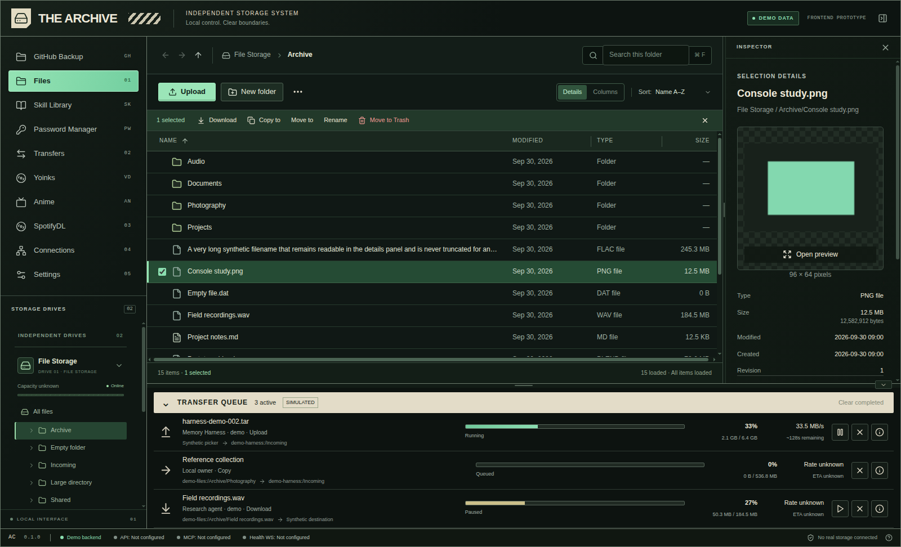

# The Archive



The Archive is a local desktop console for a home media server. Browse disks, follow transfers, and manage repository backups from one window. A separate Python service owns the storage and job queue, so closing the desktop leaves service jobs running.

## What you can do

- Browse up to 16 independent volumes. Upload, download, copy, move, rename, and recover files from per-drive Trash.
- Mirror GitHub repositories onto a dedicated volume and browse their source.
- Manage a skill library and a password vault. Each integration has its own access permissions.
- Connect optional music, video, and anime workers. Follow their progress alongside file transfers.

## Try the desktop

Use a Linux graphical session with a working Chromium sandbox, Node.js **24.x**, and npm. The backend requires **Python 3.11 or later**. For a first look, download and extract this repository or clone it using its GitHub **Code** button. Open a terminal in the folder containing `package.json` and run:

```sh
npm ci
npm run build
npm run desktop:demo
```

Demo mode opens the Electron app with synthetic drives and files. It needs no service, credentials, or mounted disks. Restart the app to reset the demo. For browser-based frontend development, use `npm run dev` and open `http://127.0.0.1:4173`. Native file pickers and the live service connection run in Electron.

## Connect your own storage

Start with [the backend configuration example](apps/backend/config.example.json). You can validate it before setting up any disks:

```sh
npm run package:backend
python3 release/archive-console-backend.pyz --config apps/backend/config.example.json --check-config
```

The example reports zero volumes and no listener. For a live service, make a private config with an absolute `statePath` for the SQLite file in a private directory separate from the managed disks, a loopback listener, and a volume entry for each verified mount. Volume identity includes the filesystem UUID, mount point, and expected filesystem. Verify these on the target host. Generate an owner secret in your password manager, then supply it when the service's interactive `--enroll-owner` option prompts for it. The desktop can read the same secret from an owner-only file (mode 0600). Run the service under its dedicated account.

With the backend running, export `ARCHIVE_SERVICE_ENDPOINT` and `ARCHIVE_SERVICE_TOKEN_FILE` in the desktop shell and run `npm run desktop`. The desktop opens in unconfigured mode until a service is configured. The repository includes Linux systemd templates for deployment. Review them against the target host before installing. Real-disk recovery and power-loss behavior require qualification on your hardware.

### Private settings

The backend example has these initial settings:

| Backend key | Default | Purpose |
| --- | --- | --- |
| `version` | `1` | Configuration schema version |
| `statePath` | `null` | Private service database file |
| `listen` | `null` | Core HTTP listener, with loopback host and port |
| `volumes` | `[]` | Managed storage roots and their expected mount identities |
| `maxWorkers` | `2` | Concurrent job limit |
| `maxPendingJobs` | `128` | Pending job limit |
| `minFreeBytes` | `67108864` | Minimum free-space reserve in bytes |
| `telemetry` | Disabled | Optional endpoint with a 30-second reporting interval |

[.env.example](.env.example) lists the available process settings. Export only the values you need. Electron and Python do not automatically load this file.

| Environment variable | Purpose | Example or default |
| --- | --- | --- |
| `ARCHIVE_CONSOLE_MODE` | Desktop data source | `demo` for fixtures, unset for service mode |
| `ARCHIVE_SERVICE_ENDPOINT` | Backend origin | `http://127.0.0.1:8123` |
| `ARCHIVE_SERVICE_TOKEN_FILE` | Private owner credential file | Absolute path to a mode-0600 file |
| `ARCHIVE_SERVICE_TOKEN` | Direct bearer credential if a file is unavailable | Unset when using a token file |
| `ARCHIVE_DEPLOYMENT_CONFIG` | Deployment script settings | Defaults to `deploy/local.json` |
| `ARCHIVE_ANIME_SPOOL` | Anime worker spool directory | Worker-managed path |
| `ARCHIVE_GIT_SECRET` | Git worker credential file | Worker-managed path |
| `CHROMIUM_PATH` | Browser executable for renderer tests | Path to Chromium |
| `ARCHIVE_PACKAGED_BINARY` | Packaged executable for native tests | Path to the built Linux executable |
| `SOURCE_DATE_EPOCH` | Reproducible backend package timestamp | `0` or an integer Unix timestamp |
| `electron_config_cache` | Electron download cache for packaging | Directory on the build host |

For deployment scripts, copy [deploy/local.example.json](deploy/local.example.json) to `deploy/local.json`. Set the entries used by the services you intend to deploy.

| Deployment setting | Value to supply |
| --- | --- |
| `RUNTIME_ROOT` | Absolute directory for the installed service, such as `/srv/the-archive/runtime` |
| `DATA_MOUNT`, `DATA_UUID` | Data mount point and verified filesystem UUID |
| `GIT_MOUNT`, `GIT_UUID` | Git backup mount point and verified filesystem UUID |
| `FILES_MOUNT`, `BACKUPS_MOUNT` | Mount points for files and backups |
| `FLEET_ENDPOINT`, `FLEET_NODE_ID` | Optional telemetry WebSocket URL (`wss://`) and a node identifier you choose |

Keep private deployment settings, tokens, databases, and credential files outside version control. The supplied ignore rules cover common private file types and `deploy/local.json`. The desktop's main process reads the service credential.

## Build and check

`npm run check:all` runs frontend type checks, lint, tests, and the renderer build, followed by backend checks and tests. The renderer build lands in `apps/desktop/dist/`. Backend packaging creates a Python executable archive and a source bundle under `release/`. For service integration tests, activate a Python 3 virtual environment so both `python` and `python3` are available, and use `umask 022` in the test shell so permission fixtures have their expected modes. The mobile, telemetry, and vault integration tests use the optional dependencies declared in the backend package. Inside the virtual environment, install them with `python -m pip install "./apps/backend[mobile,telemetry,vault]" jsonschema`.

| Location | Contents |
| --- | --- |
| `apps/desktop/` | Electron main process, React renderer, and desktop tests |
| `apps/backend/` | Storage service, example configuration, and Python tests |
| `apps/music-worker/`, `apps/video-worker/`, `apps/anime-worker/` | Optional acquisition workers |
| `contracts/` | Machine-readable integration schemas |
| `deploy/` | Deployment settings and service templates |
| `scripts/` | Build, verification, and deployment utilities |

## Contributing

Issues and pull requests are welcome. Include the operating system, the mode you used, and steps to reproduce a problem. Remove credentials and private storage details from reports. Contributions are accepted under the project license.

## License

The Archive is source-available under the **PolyForm Noncommercial License 1.0.0**. You may use, modify, and share it for purposes permitted by the license. Selling it or using it commercially requires separate permission. Open a repository issue to request commercial terms. Bundled third-party code retains its own notices. [Read the full license](LICENSE).
